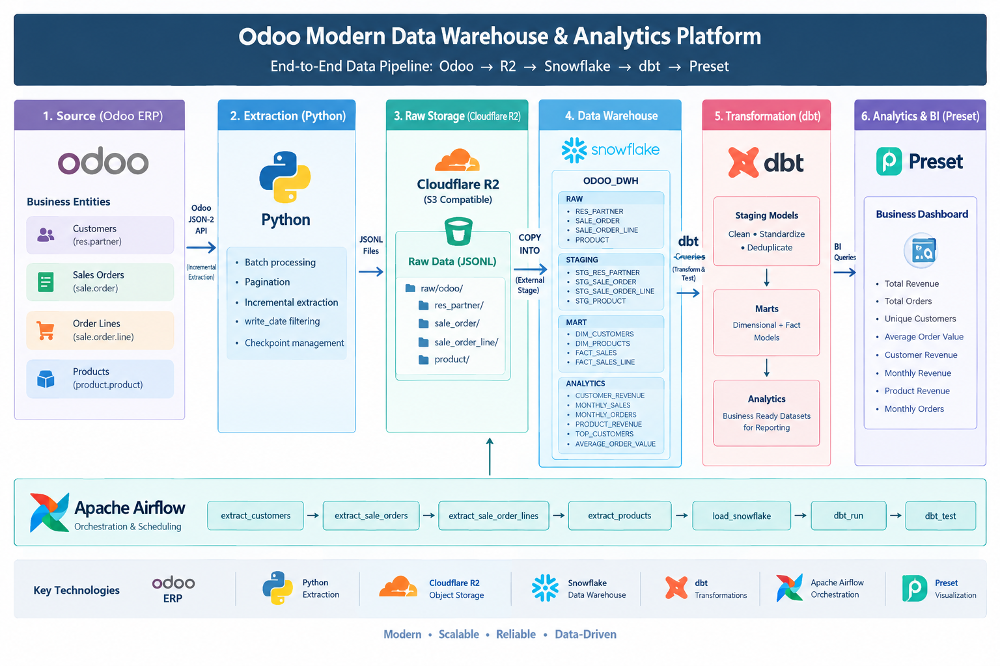

# Odoo Modern Data Warehouse & Analytics Platform

A modern Data Engineering pipeline that extracts business data from **Odoo ERP**, stores raw data in **Cloudflare R2**, loads it into **Snowflake**, transforms it using **dbt**, orchestrates the workflow with **Apache Airflow**, and provides business analytics through **Preset**.

The project demonstrates an end-to-end **API-based ELT pipeline** with incremental extraction, checkpointing, cloud object storage, Snowflake data warehousing, dimensional modeling, data quality testing, orchestration, and business reporting.

---

## Architecture



The pipeline follows a modern data engineering architecture:

Odoo → Python → Cloudflare R2 → Snowflake → dbt → Preset

Apache Airflow orchestrates the complete workflow from extraction to data quality testing.

```text
                         ┌─────────────────────┐
                         │      Odoo ERP       │
                         │   Odoo JSON-2 API   │
                         └──────────┬──────────┘
                                    │
                                    │ API Extraction
                                    ▼
                         ┌─────────────────────┐
                         │   Python Extractor  │
                         │                     │
                         │ • Batch extraction  │
                         │ • Incremental load  │
                         │ • Checkpoints       │
                         └──────────┬──────────┘
                                    │
                                    ▼
                         ┌─────────────────────┐
                         │    Cloudflare R2    │
                         │     Raw Storage     │
                         │                     │
                         │ JSONL files         │
                         │ Date partitioned    │
                         └──────────┬──────────┘
                                    │
                                    │ COPY INTO
                                    ▼
                    ┌─────────────────────────────┐
                    │          Snowflake          │
                    │                             │
                    │  RAW                        │
                    │   ├── RES_PARTNER           │
                    │   ├── SALE_ORDER            │
                    │   ├── SALE_ORDER_LINE       │
                    │   └── PRODUCT               │
                    │                             │
                    │  STAGING                    │
                    │   ├── STG_RES_PARTNER       │
                    │   ├── STG_SALE_ORDER        │
                    │   ├── STG_SALE_ORDER_LINE   │
                    │   └── STG_PRODUCT           │
                    │                             │
                    │  MART                       │
                    │   ├── DIM_CUSTOMERS         │
                    │   ├── DIM_PRODUCTS          │
                    │   ├── FACT_SALES            │
                    │   └── FACT_SALES_LINE       │
                    │                             │
                    │  ANALYTICS                  │
                    │   ├── CUSTOMER_REVENUE      │
                    │   ├── MONTHLY_SALES         │
                    │   ├── MONTHLY_ORDERS        │
                    │   ├── PRODUCT_REVENUE       │
                    │   ├── TOP_CUSTOMERS         │
                    │   └── AVERAGE_ORDER_VALUE   │
                    └──────────────┬──────────────┘
                                   │
                                   │ dbt
                                   ▼
                         ┌─────────────────────┐
                         │       Preset        │
                         │     Dashboard       │
                         │                     │
                         │ • Revenue           │
                         │ • Orders            │
                         │ • Customers         │
                         │ • Products          │
                         │ • AOV               │
                         └─────────────────────┘

                         Apache Airflow
                    ─────────────────────────
                    Orchestrates the pipeline
```

---

## Project Overview

Many businesses use Odoo as their ERP system for managing customers, sales, products, and orders. However, operational ERP databases are not always ideal for analytical reporting and management dashboards.

This project builds a modern analytics platform that separates operational data extraction from analytical workloads.

The pipeline extracts data from Odoo, stores the raw data in cloud object storage, loads it into Snowflake, transforms it using dbt, and exposes business-ready analytics through Preset.

---

## Business Use Case

The platform provides analytics around:

* Customer revenue
* Sales performance
* Monthly revenue
* Monthly order volume
* Product revenue
* Product quantities
* Average order value
* Top customers
* Sales order line-level analysis

This allows business users to analyze sales performance without directly querying the operational Odoo system.

---

## Data Sources

The project currently extracts four important Odoo entities:

### 1. Customers

Odoo model:

```text
res.partner
```

Key fields:

```text
id
name
email
phone
create_date
write_date
```

### 2. Sales Orders

Odoo model:

```text
sale.order
```

Key fields:

```text
id
name
partner_id
date_order
state
amount_total
create_date
write_date
```

### 3. Sales Order Lines

Odoo model:

```text
sale.order.line
```

Key fields:

```text
id
order_id
product_id
product_uom_qty
price_unit
price_subtotal
create_date
write_date
```

### 4. Products

Odoo model:

```text
product.product
```

Key fields:

```text
id
name
default_code
list_price
create_date
write_date
```

---

## Technology Stack

| Layer              | Technology      |
| ------------------ | --------------- |
| Source ERP         | Odoo            |
| API                | Odoo JSON-2 API |
| Extraction         | Python          |
| Raw Storage        | Cloudflare R2   |
| Data Warehouse     | Snowflake       |
| Transformation     | dbt             |
| Orchestration      | Apache Airflow  |
| BI / Visualization | Preset          |
| Data Format        | JSONL           |
| Version Control    | Git / GitHub    |

---

## Pipeline Workflow

### 1. Extract from Odoo

Python extractors communicate with the Odoo JSON-2 API.

The extraction supports:

* Pagination
* Batch processing
* Incremental extraction
* `write_date` based filtering
* Checkpoint-based state management

Example incremental condition:

```python
domain.append(["write_date", ">", last_write_date])
```

This allows subsequent pipeline runs to retrieve records modified after the previous successful extraction.

---

### 2. Store Raw Data in Cloudflare R2

Extracted records are written as JSONL files.

Example:

```text
raw/odoo/
├── res_partner/
│   └── load_date=YYYY-MM-DD/
│       └── res_partner.jsonl
│
├── sale_order/
│   └── load_date=YYYY-MM-DD/
│       └── sale_order.jsonl
│
├── sale_order_line/
│   └── load_date=YYYY-MM-DD/
│       └── sale_order_line.jsonl
│
└── product/
    └── load_date=YYYY-MM-DD/
        └── product.jsonl
```

Cloudflare R2 provides an S3-compatible object-storage layer between the source system and Snowflake.

---

### 3. Load into Snowflake RAW

Snowflake reads the JSONL files from the R2 external stage using `COPY INTO`.

The RAW layer preserves the extracted source data in a warehouse-accessible format.

Current RAW tables:

```text
ODOO_DWH.RAW
├── RES_PARTNER
├── SALE_ORDER
├── SALE_ORDER_LINE
└── PRODUCT
```

---

### 4. dbt Staging Layer

The staging layer cleans and standardizes the RAW data.

Examples of transformations:

* Column renaming
* String trimming
* Null handling
* Relationship normalization
* Deduplication

For example, duplicate records are handled using:

```sql
row_number() over (
    partition by id
    order by write_date desc
)
```

Only the latest version of a record is retained.

Current staging models:

```text
STG_RES_PARTNER
STG_SALE_ORDER
STG_SALE_ORDER_LINE
STG_PRODUCT
```

---

### 5. dbt Data Mart Layer

The transformed staging data is organized into dimensional and fact models.

```text
MART
├── DIM_CUSTOMERS
├── DIM_PRODUCTS
├── FACT_SALES
└── FACT_SALES_LINE
```

### Dimension tables

`DIM_CUSTOMERS`

Contains customer-level business information.

`DIM_PRODUCTS`

Contains product-level business information.

### Fact tables

`FACT_SALES`

Contains sales-order-level information.

`FACT_SALES_LINE`

Contains detailed sales-line information including product, quantity, unit price, and line revenue.

---

## Analytics Layer

The analytics layer provides business-ready datasets for reporting.

Current models:

```text
ANALYTICS
├── CUSTOMER_REVENUE
├── MONTHLY_SALES
├── MONTHLY_ORDERS
├── PRODUCT_REVENUE
├── TOP_CUSTOMERS
└── AVERAGE_ORDER_VALUE
```

### Customer Revenue

Provides:

* Total orders
* Total revenue
* Average order value
* Customer-level revenue analysis

### Monthly Sales

Provides monthly sales revenue trends.

### Monthly Orders

Provides monthly order volume.

### Product Revenue

Provides:

* Product revenue
* Quantity sold
* Number of orders
* Average unit price

### Top Customers

Ranks customers based on revenue.

### Average Order Value

Calculates:

```text
Average Order Value =
Total Revenue / Total Orders
```

---

## Airflow Orchestration

Apache Airflow orchestrates the complete pipeline.

Current workflow:

```text
extract_customers
        ↓
extract_sale_orders
        ↓
extract_sale_order_lines
        ↓
extract_products
        ↓
load_snowflake
        ↓
dbt_run
        ↓
dbt_test
```

Airflow is responsible for coordinating extraction, warehouse loading, transformation, and data-quality validation.

---

## Data Quality

dbt tests are implemented for important source and model constraints.

Examples include:

* `not_null`
* `unique`

The final pipeline validation completed successfully with:

```text
14 models
32 data tests

PASS = 32
WARN = 0
ERROR = 0
SKIP = 0
```

This confirms that the current pipeline and dbt data-quality tests execute successfully end-to-end.

---

## Incremental Processing

The extraction layer uses Odoo's `write_date` field to identify records changed since the previous successful extraction.

Example:

```text
First run
    ↓
Extract all records
    ↓
Save latest write_date
    ↓
Next run
    ↓
Extract records where write_date > checkpoint
    ↓
Save new checkpoint
```

Checkpoint files are maintained separately for each entity.

Example:

```text
data/checkpoints/
├── res_partner.json
├── sale_order.json
├── sale_order_line.json
└── product.json
```

This avoids performing a complete source extraction on every incremental run.

---

## Project Structure

```text
odoo-data-extractor/
│
├── config/
│   └── settings.py
│
├── src/
│   ├── client/
│   │   ├── odoo_client.py
│   │   └── r2_client.py
│   │
│   ├── extractors/
│   │   ├── customers.py
│   │   ├── sale_orders.py
│   │   ├── sale_order_lines.py
│   │   └── product_products.py
│   │
│   ├── loaders/
│   │   └── jsonl_loader.py
│   │
│   └── utils/
│       └── checkpoint.py
│
├── scripts/
│   ├── run_extraction.py
│   ├── run_sale_order_extraction.py
│   ├── run_sale_order_line_extraction.py
│   ├── run_product_extraction.py
│   └── load_snowflake.py
│
├── airflow/
│   └── dags/
│       └── odoo_pipeline.py
│
├── dbt/
│   └── odoo_analytics/
│       ├── models/
│       │   ├── staging/
│       │   ├── mart/
│       │   └── analytics/
│       ├── macros/
│       └── dbt_project.yml
│
├── data/
│   ├── raw/
│   └── checkpoints/
│
├── requirements.txt
├── .gitignore
└── README.md
```

---

## Key Data Engineering Concepts Demonstrated

This project demonstrates practical implementation of:

* REST/API-based data extraction
* Odoo ERP integration
* Batch processing
* Pagination
* Incremental data extraction
* Checkpoint management
* JSONL processing
* Cloud object storage
* S3-compatible storage
* Snowflake external stages
* Snowflake `COPY INTO`
* RAW / STAGING / MART architecture
* Dimensional modeling
* Fact and dimension tables
* Deduplication using window functions
* dbt transformations
* dbt testing
* Airflow orchestration
* Business analytics
* BI dashboard development

---

## Key Design Decisions

### Why Cloudflare R2?

R2 provides an S3-compatible object-storage layer for raw extracted data.

It also creates a separation between:

```text
Source system
      ↓
Raw storage
      ↓
Data warehouse
```

This makes the pipeline easier to reason about and provides a persistent raw-data layer.

### Why Snowflake?

Snowflake provides a scalable cloud data warehouse for analytical workloads and integrates well with object storage and dbt.

### Why dbt?

dbt separates SQL transformations from the raw ingestion layer and provides:

* Modular models
* Dependency management
* Testing
* Documentation capability
* Reusable transformations

### Why Airflow?

Airflow provides orchestration and dependency management across extraction, loading, transformation, and testing tasks.

---

## Dashboard

The final Preset dashboard provides business-level visibility into:

* Total Revenue
* Total Orders
* Unique Customers
* Average Order Value
* Customer Revenue
* Monthly Revenue
* Product Revenue
* Monthly Orders

Dashboard:

**Odoo Management Analytics Dashboard**

Screenshots can be added to this README after the final GitHub cleanup.

---

## How to Run

### 1. Configure environment variables

Create a `.env` file containing the required Odoo, Cloudflare R2, and Snowflake credentials.

Do not commit credentials to GitHub.

---

### 2. Install Python dependencies

```bash
pip install -r requirements.txt
```

---

### 3. Run an extraction

Example:

```bash
python -m scripts.run_sale_order_extraction
```

Other available extractors:

```bash
python -m scripts.run_extraction
python -m scripts.run_sale_order_line_extraction
python -m scripts.run_product_extraction
```

---

### 4. Load data into Snowflake

```bash
python scripts/load_snowflake.py
```

---

### 5. Run dbt

```bash
cd dbt
source .venv/bin/activate

dbt run
dbt test
```

---

### 6. Run through Airflow

Start Airflow and trigger:

```text
odoo_pipeline
```

The DAG orchestrates:

```text
Odoo extraction
      ↓
R2 upload
      ↓
Snowflake loading
      ↓
dbt transformation
      ↓
dbt testing
```

---

## Future Improvements

This project is intentionally designed as a portfolio/POC implementation.

Potential future improvements include:

* Automated daily scheduling
* More Odoo entities
* Source freshness monitoring
* Stronger pipeline observability
* Alerting and notifications
* More comprehensive data-quality checks
* CI/CD for dbt
* Infrastructure-as-Code
* Production-grade metadata and audit logging

These improvements are outside the current POC scope.

---

## Author

**Mahalakshmi**

Data Engineering | Python | SQL | Snowflake | dbt | Airflow | Spark | Kafka

This project is part of my Data Engineering portfolio, demonstrating an end-to-end modern data pipeline built around a real-world ERP analytics use case.
